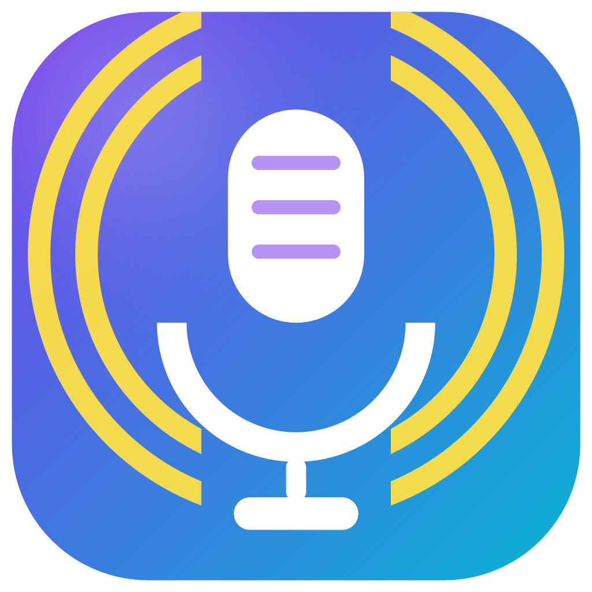
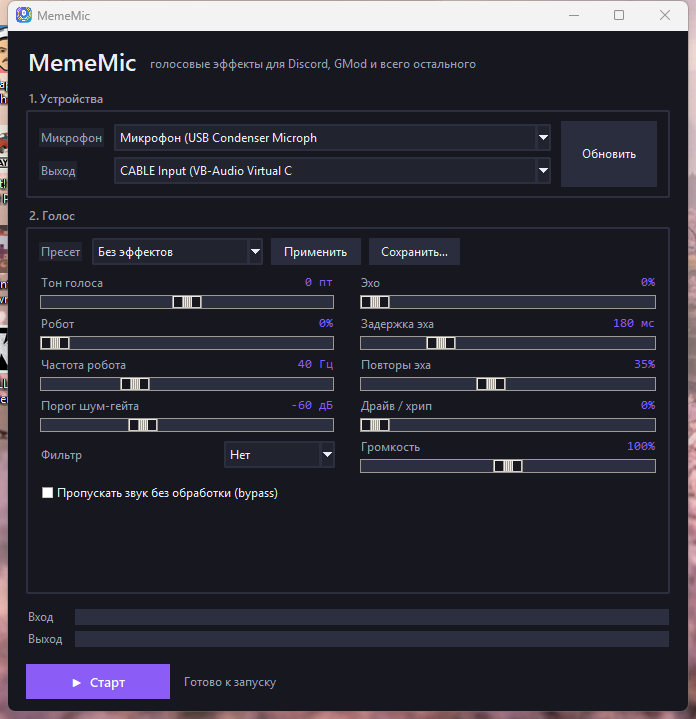

# MemeMic

<p align="center"></p>

**Real-time voice changer for Windows with meme-ready presets.**  
Feed your mic through effects and into a virtual cable, so Discord, games, Zoom, OBS — anything that can pick a microphone — hears the processed voice.




> The app interface is currently in Russian. Preset names below are shown as they appear in the app; you can add your own presets with any names.

## How it works

```
microphone ──► MemeMic (effects) ──► VB-Cable "CABLE Input"
                                            │
                                            ▼
                          Discord / game hears "CABLE Output"
```

MemeMic opens your real microphone and a playback device (`CABLE Input`) and streams processed audio between them. No drivers are installed by MemeMic itself — you need **VB-Audio Virtual Cable**, a free virtual audio cable.

## Features

- Pitch shift from −12 to +12 semitones (phase vocoder, identity phase locking);
- robot / ring-modulation voice, echo, drive (soft saturation);
- phone, muffled and thin filters;
- noise gate, output volume, bypass;
- 9 built-in presets, including meme voices;
- save your own presets to `%APPDATA%\MemeMic\presets.json` (shareable JSON);
- input / output level meters, underrun counter in the log;
- selected devices and settings persist between launches;
- everything runs locally — no accounts, no telemetry, no network access.

## Requirements

- Windows 10 or 11 (x64);
- [VB-Audio Virtual Cable](https://vb-audio.com/Cable/) — free, separate download;
- either the prebuilt `MemeMic.exe` **or** Python 3.10+ (tested on 3.13).

### Install VB-Cable (one time)

1. Download the VB-Cable driver pack from the official site: <https://vb-audio.com/Cable/>.
2. Unpack the archive and run `VBCABLE_Setup_x64.exe` **as administrator**.
3. Click **Install Driver**, then **reboot** Windows.

After the reboot you will see two new devices:

| Device | Type | Used by |
|---|---|---|
| `CABLE Input (VB-Audio Virtual Cable)` | playback | MemeMic writes here |
| `CABLE Output (VB-Audio Virtual Cable)` | recording | Discord / games read here |

> The driver is **not** bundled with this project. VB-Audio's license does not allow redistributing it inside another installer, and it is easy to download from the official site. This repository contains only MemeMic's own code.

## Install

### Option A — prebuilt executable

1. Download `MemeMic.exe` from the [Releases](../../releases) page.
2. Run it. No installation or Python required.

Windows SmartScreen may warn about an unsigned executable: **More info → Run anyway**. Some antivirus engines also flag PyInstaller-packed binaries as “unknown”; the source is right here if you prefer to build it yourself.

### Option B — from source

```bat
git clone https://github.com/sunsleepve/MemeMic.git
cd MemeMic
install.bat
run.bat
```

`install.bat` creates `.venv` and installs the dependencies (`numpy`, `scipy`, `sounddevice`) from `requirements.txt`.

Manual setup, if you prefer:

```bat
py -3 -m venv .venv
.venv\Scripts\python.exe -m pip install -r requirements.txt
.venv\Scripts\python.exe -m mememic
```

List the audio devices without starting the GUI:

```bat
.venv\Scripts\python.exe -m mememic --list-devices
```

## Quick start

1. Start `MemeMic.exe` (or `run.bat`).
2. **Input** — your real microphone (a device *without* “CABLE” in the name).
3. **Output** — `CABLE Input (VB-Audio Virtual Cable)`.
4. Pick a preset, for example **“Мистер, вы потеряли кошелёк”** (robot from the meme), and click **Применить** (*Apply*).
5. Click **Старт** (*Start*). The input meter should move when you speak.

To hear yourself while tuning, temporarily set **Output** to your headphones. Never use speakers — you will get acoustic feedback.

### Discord

`User Settings → Voice & Video`:

- **Input Device** — `CABLE Output (VB-Audio Virtual Cable)`;
- disable **Noise Suppression (Krisp)**, **Echo Cancellation** and **Automatic Gain Control** — they destroy the effects;
- set **Input Sensitivity** to manual and adjust it while watching the meter;
- use **Let's Check** to hear the processed voice.

### Games (GMod, CS, Source games, etc.)

Pick `CABLE Output (VB-Audio Virtual Cable)` as the microphone in the game settings. Some games only use the Windows default recording device; in that case set it system-wide:

`Settings → System → Sound → All sound devices → CABLE Output → Set as default`.

### OBS / browsers / any other app

Choose `CABLE Output` as the microphone. In OBS you can also add an **Audio Input Capture** source pointing at it.

## Built-in presets

| Preset (as shown in the app) | What it does |
|---|---|
| Без эффектов | clean voice (useful reference) |
| Робот | 45 Hz ring modulation |
| Демон | pitch −6, drive, muffled filter, a bit of echo |
| Бурундук | pitch +7, light drive |
| Телефон | 300–3400 Hz band + drive |
| Пещера | 220 ms echo with repeats, pitch −1 |
| Инопланетянин | pitch +4, 14 Hz robot, echo |
| Монстр | pitch −9, heavy drive, echo |
| Мистер, вы потеряли кошелёк | meme robot: pitch −1.5, 48 Hz robot, phone filter, drive, short echo |

## Custom presets

Tune the sliders, then click **Сохранить…** (*Save…*) and give the preset a name. It is stored in:

```
%APPDATA%\MemeMic\presets.json
```

The file is plain JSON and can be shared — copy it to another machine, or commit a collection to a gist. Only values that differ from the defaults are written.

Example:

```json
{
  "Deep radio": {
    "pitch": -4.0,
    "filter": "phone",
    "drive": 35.0,
    "echo_mix": 0.15,
    "echo_delay_ms": 120.0,
    "volume": 1.3
  },
  "Alien": {
    "pitch": 5.0,
    "robot_mix": 0.6,
    "robot_freq": 18.0,
    "echo_mix": 0.3
  }
}
```

### Parameters

| Key | Range | Default | Meaning |
|---|---|---|---|
| `pitch` | −12 … +12 | `0` | Pitch shift in semitones |
| `robot_mix` | 0 … 1 | `0` | Ring-modulation depth |
| `robot_freq` | 5 … 120 | `40` | Robot modulation frequency (Hz) |
| `echo_mix` | 0 … 1 | `0` | Echo wet level |
| `echo_delay_ms` | 40 … 600 | `180` | Echo delay (ms) |
| `echo_feedback` | 0 … 0.8 | `0.35` | Echo repeats |
| `drive` | 0 … 100 | `0` | Soft saturation amount |
| `filter` | `"none"` / `"phone"` / `"muffled"` / `"thin"` | `"none"` | Tone filter |
| `volume` | 0 … 2 | `1` | Output gain |
| `gate_db` | −80 … −20 | `−60` | Noise-gate threshold; `−80` = off |
| `bypass` | `true` / `false` | `false` | Pass audio through untouched |

## Troubleshooting

| Symptom | Fix |
|---|---|
| `CABLE Input` is missing | VB-Cable is not installed, or Windows has not been rebooted after installation |
| “Could not open device” | close apps that already hold the cable (another voice changer, OBS monitoring), press **Обновить** (*Refresh*), or try another device |
| Other people hear nothing | MemeMic's output must be `CABLE Input`; Discord/game input must be `CABLE Output` |
| Crackles, hiss, clipping | lower **Драйв** and **Громкость**, make sure the input is not `CABLE Output` |
| Voice disappears between words | lower the noise-gate threshold or set it to −80 dB |
| Echo on the other side | disable Discord echo cancellation and do not monitor through speakers |
| Choppy audio / dropouts | close CPU-heavy apps; check `%APPDATA%\MemeMic\log.txt` for the `underruns` counter |
| GUI does not start | run from a console: `.venv\Scripts\python.exe -m mememic` to see the traceback |
| Sounddevice / PortAudio error | re-run `install.bat` |

Reset settings: delete `%APPDATA%\MemeMic\settings.json`.  
Reset custom presets: delete `%APPDATA%\MemeMic\presets.json`.

## Build the executable

```bat
build.bat
```

The script installs PyInstaller into `.venv` and produces `dist\MemeMic.exe` (one-file, windowed, ~53 MB).

## Project structure

```
MemeMic/
├── mememic/
│   ├── __main__.py    # python -m mememic, --list-devices
│   ├── gui.py         # Tkinter UI, preset save/apply
│   ├── engine.py      # input/output streams, queue, resampling, PLC
│   ├── dsp.py         # pitch shifter, gate, robot, echo, filters, drive
│   ├── devices.py     # device list, deduplicated across host APIs
│   └── config.py      # settings.json / presets.json
├── tests/test_dsp.py  # 14 DSP tests, no audio hardware needed
├── scripts/           # cable loop test, mic→cable chain test, device check
├── assets/mememic.ico # app / exe icon
├── docs/screenshot.png
├── docs/logo.png
├── main.py            # PyInstaller entry point
├── build.bat          # build dist\MemeMic.exe
├── install.bat        # create .venv and install dependencies
├── run.bat            # run from source
└── requirements.txt
```

Run the tests:

```bat
.venv\Scripts\python.exe -m unittest discover -s tests -v
```

CI runs the same suite on Windows with Python 3.11–3.13 (`.github/workflows/tests.yml`).

## Latency

The pitch shifter uses a 1024-sample STFT with 75 % overlap (≈21 ms hop at 48 kHz), plus a 512-sample processing block, the queue and the driver buffers. Expect roughly **100–200 ms** end-to-end. That is fine for speech and meme lines; it is noticeable when singing.

## Limitations

- Windows only (virtual cable + WASAPI).
- The phase vocoder shifts pitch precisely, but formants are not preserved: shifts beyond ±7 semitones sound like an effect, not like another person.
- No voice cloning / AI voice models. Presets are DSP effects only.
- No global hotkeys yet — use push-to-talk in Discord or the game.
- Audio processing runs in the audio callback; on a very weak CPU, reduce the number of effects.

## License

[MIT](LICENSE) © 2026 MemeMic contributors.

## Disclaimer

MemeMic is an independent hobby project. It is **not affiliated with, endorsed by or sponsored by** Voicemod, VB-Audio, Discord or any game mentioned here. All product names and trademarks belong to their respective owners. The VB-Cable driver is not included and must be downloaded from the official VB-Audio website under its own license.
