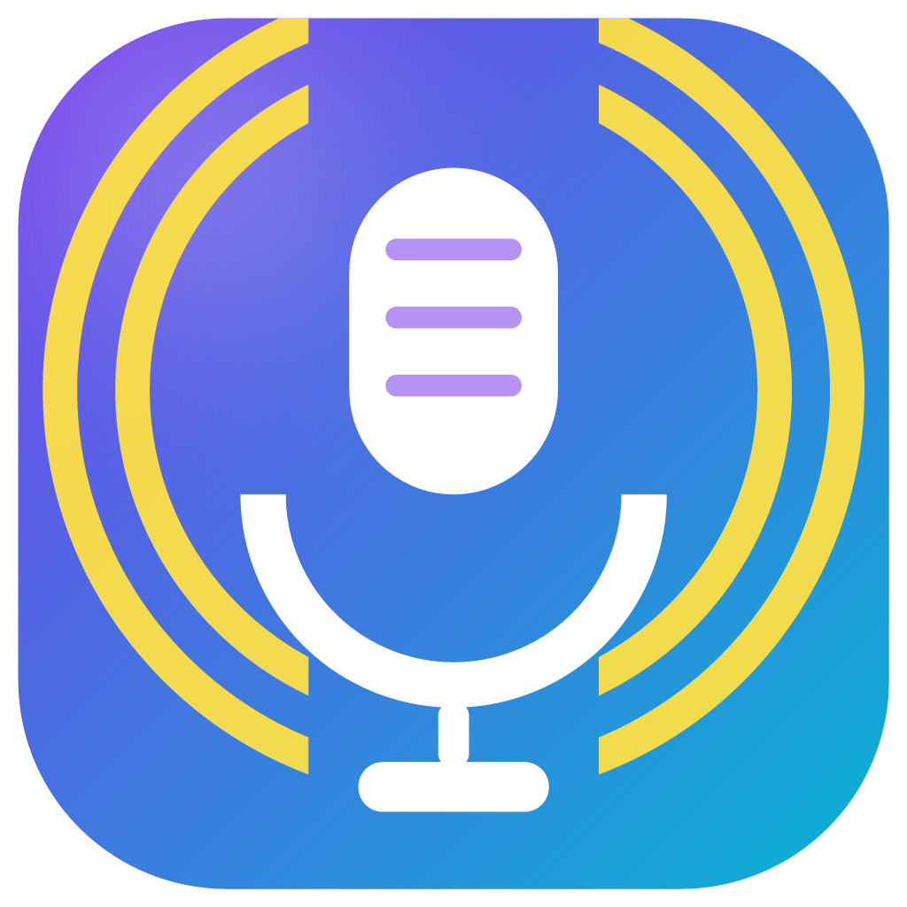
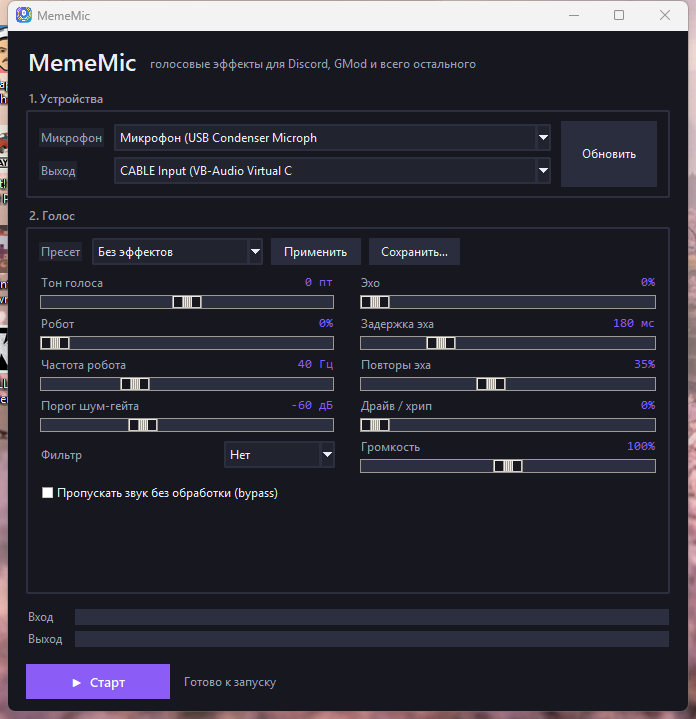

# MemeMic

<p align="center">
  <a href="README.md">English</a> · <a href="README.ru.md">Русский</a>
</p>

<p align="center"></p>

**Войс-ченджер для Windows в реальном времени, с мемными пресетами.**  
Микрофон → эффекты → виртуальный кабель. Голос слышат Discord, игры, Zoom, OBS — любая программа, где можно выбрать микрофон.




## Как это работает

```
микрофон ──► MemeMic (эффекты) ──► VB-Cable «CABLE Input»
                                          │
                                          ▼
                        Discord / игра слышит «CABLE Output»
```

MemeMic открывает настоящий микрофон и устройство воспроизведения (`CABLE Input`), а между ними пропускает обработанный звук. Сам ченджер драйверы не ставит — нужен бесплатный виртуальный кабель **VB-Audio Virtual Cable**.

## Возможности

- сдвиг тона от −12 до +12 полутонов (фазовый вокодер с identity phase locking);
- «робот» (кольцевая модуляция), эхо, драйв/хрип;
- телефонный, глухой и «тонкий» фильтры;
- шум-гейт, громкость, bypass;
- 9 встроенных пресетов, включая мемные;
- свои пресеты в `%APPDATA%\MemeMic\presets.json` — обычный JSON, можно шарить;
- индикаторы уровня входа/выхода, счётчик underrun'ов в логе;
- выбранные устройства и настройки запоминаются между запусками;
- всё работает локально: без аккаунтов, телеметрии и сети.

## Что нужно

- Windows 10/11 (x64);
- [VB-Audio Virtual Cable](https://vb-audio.com/Cable/) — бесплатно, скачивается отдельно;
- готовый `MemeMic.exe` **или** Python 3.10+ (проверено на 3.13).

### Установка VB-Cable (один раз)

1. Скачай драйвер с официального сайта: <https://vb-audio.com/Cable/>.
2. Распакуй архив и запусти `VBCABLE_Setup_x64.exe` **от имени администратора**.
3. Нажми **Install Driver** и **перезагрузи ПК**.

После перезагрузки появятся два устройства:

| Устройство | Тип | Кто использует |
|---|---|---|
| `CABLE Input (VB-Audio Virtual Cable)` | воспроизведение | сюда пишет MemeMic |
| `CABLE Output (VB-Audio Virtual Cable)` | запись | отсюда читают Discord и игры |

> Драйвер **не** входит в проект. Лицензия VB-Audio запрещает встраивать его в чужой установщик, да и скачать его с официального сайта несложно. В репозитории только код MemeMic.

## Установка

### Вариант А — готовый exe

1. Скачай `MemeMic.exe` со страницы [Releases](../../releases).
2. Запусти. Python и установка не нужны.

SmartScreen может предупредить о неподписанном exe: **Подробнее → Выполнить в любом случае**. Некоторые антивирусы тоже ругаются на упаковку PyInstaller — исходники лежат рядом, можно собрать самому.

### Вариант Б — из исходников

```bat
git clone https://github.com/sunsleepve/MemeMic.git
cd MemeMic
install.bat
run.bat
```

`install.bat` создаст `.venv` и поставит зависимости (`numpy`, `scipy`, `sounddevice`) из `requirements.txt`.

Вручную:

```bat
py -3 -m venv .venv
.venv\Scripts\python.exe -m pip install -r requirements.txt
.venv\Scripts\python.exe -m mememic
```

Посмотреть список аудио-устройств без запуска GUI:

```bat
.venv\Scripts\python.exe -m mememic --list-devices
```

## Быстрый старт

1. Запусти `MemeMic.exe` (или `run.bat`).
2. **Микрофон** — свой настоящий микрофон (в названии нет «CABLE»).
3. **Выход** — `CABLE Input (VB-Audio Virtual Cable)`.
4. Выбери пресет, например **«Мистер, вы потеряли кошелёк»**, и нажми **Применить**.
5. Нажми **Старт**. Индикатор «Вход» должен дёргаться, когда ты говоришь.

Чтобы слышать себя при настройке, временно выбери выходом наушники. Колонки не используй — будет акустическая обратная связь.

### Discord

`Настройки пользователя → Голос и видео`:

- **Устройство ввода** — `CABLE Output (VB-Audio Virtual Cable)`;
- выключи **Шумоподавление (Krisp)**, **Эхоподавление** и **Автоматическую регулировку усиления** — они портят эффекты;
- **Чувствительность входа** — ручной режим, ползунок по индикатору;
- нажми «Проверить микрофон», чтобы услышать результат.

### Игры (GMod, CS, Source и другие)

Выбери `CABLE Output (VB-Audio Virtual Cable)` микрофоном в настройках игры. Некоторые игры берут только системное устройство записи — тогда сделай кабель устройством по умолчанию:

`Параметры → Система → Звук → Все устройства → CABLE Output → Использовать как устройство по умолчанию`.

### OBS / браузер / любая программа

Выбери `CABLE Output` как микрофон. В OBS можно добавить источник «Захват входного аудиопотока» с этого устройства.

## Встроенные пресеты

| Пресет | Что делает |
|---|---|
| Без эффектов | чистый голос (точка отсчёта) |
| Робот | кольцевая модуляция 45 Гц |
| Демон | тон −6, драйв, глухой фильтр, немного эха |
| Бурундук | тон +7, лёгкий драйв |
| Телефон | полоса 300–3400 Гц + драйв |
| Пещера | эхо 220 мс с повторами, тон −1 |
| Инопланетянин | тон +4, «робот» 14 Гц, эхо |
| Монстр | тон −9, сильный драйв, эхо |
| Мистер, вы потеряли кошелёк | мемный робот: тон −1.5, робот 48 Гц, телефонный фильтр, драйв, короткое эхо |

## Свои пресеты

Настрой ползунки, нажми **Сохранить…** и введи название. Пресет попадёт в:

```
%APPDATA%\MemeMic\presets.json
```

Это обычный JSON — файл можно копировать на другую машину или выкладывать в gist. Сохраняются только отличия от значений по умолчанию.

Пример:

```json
{
  "Глубокое радио": {
    "pitch": -4.0,
    "filter": "phone",
    "drive": 35.0,
    "echo_mix": 0.15,
    "echo_delay_ms": 120.0,
    "volume": 1.3
  },
  "Инопланетянин 2": {
    "pitch": 5.0,
    "robot_mix": 0.6,
    "robot_freq": 18.0,
    "echo_mix": 0.3
  }
}
```

### Параметры

| Ключ | Диапазон | По умолчанию | Значение |
|---|---|---|---|
| `pitch` | −12 … +12 | `0` | Сдвиг тона в полутонах |
| `robot_mix` | 0 … 1 | `0` | Глубина кольцевой модуляции |
| `robot_freq` | 5 … 120 | `40` | Частота «робота», Гц |
| `echo_mix` | 0 … 1 | `0` | Уровень эха |
| `echo_delay_ms` | 40 … 600 | `180` | Задержка эха, мс |
| `echo_feedback` | 0 … 0.8 | `0.35` | Повторы эха |
| `drive` | 0 … 100 | `0` | Мягкое ограничение (хрип) |
| `filter` | `"none"` / `"phone"` / `"muffled"` / `"thin"` | `"none"` | Тембральный фильтр |
| `volume` | 0 … 2 | `1` | Выходная громкость |
| `gate_db` | −80 … −20 | `−60` | Порог шум-гейта; `−80` = выкл |
| `bypass` | `true` / `false` | `false` | Пропускать звук без обработки |

## Если что-то не работает

| Симптом | Что делать |
|---|---|
| В списке нет `CABLE Input` | VB-Cable не установлен или ПК не перезагружен после установки |
| «Не удалось открыть устройство» | закрой программы, которые уже держат кабель (другой ченджер, мониторинг OBS), нажми **Обновить** или выбери другое устройство |
| Собеседники не слышат | выход MemeMic — `CABLE Input`, микрофон в Discord/игре — `CABLE Output` |
| Треск, шипение, клиппинг | уменьши **Драйв** и **Громкость**, проверь, что вход — не `CABLE Output` |
| Голос пропадает между словами | опусти порог шум-гейта или поставь −80 дБ |
| Эхо у собеседника | выключи эхоподавление в Discord и не слушай себя через колонки |
| Звук рвётся / провалы | закрой тяжёлые программы; посмотри счётчик `underruns` в `%APPDATA%\MemeMic\log.txt` |
| GUI не запускается | запусти из консоли: `.venv\Scripts\python.exe -m mememic` — там будет текст ошибки |
| Ошибка sounddevice / PortAudio | запусти `install.bat` заново |

Сброс настроек: удали `%APPDATA%\MemeMic\settings.json`.  
Сброс своих пресетов: удали `%APPDATA%\MemeMic\presets.json`.

## Сборка exe

```bat
build.bat
```

Скрипт поставит PyInstaller в `.venv` и соберёт `dist\MemeMic.exe` (one-file, без консоли, ~53 МБ).

## Структура проекта

```
MemeMic/
├── mememic/
│   ├── __main__.py    # python -m mememic, --list-devices
│   ├── gui.py         # интерфейс Tkinter, сохранение/применение пресетов
│   ├── engine.py      # потоки ввода/вывода, очередь, ресемплинг, PLC
│   ├── dsp.py         # питч-шифтер, гейт, робот, эхо, фильтры, драйв
│   ├── devices.py     # список устройств без дублей по host API
│   └── config.py      # settings.json / presets.json
├── tests/test_dsp.py  # 14 тестов DSP, железо не нужно
├── scripts/           # тест кабеля, сквозной тест микрофон→кабель, проверка устройств
├── assets/mememic.ico # иконка приложения и exe
├── docs/screenshot.png
├── docs/logo.png
├── main.py            # точка входа для PyInstaller
├── build.bat          # сборка dist\MemeMic.exe
├── install.bat        # .venv + зависимости
├── run.bat            # запуск из исходников
└── requirements.txt
```

Тесты:

```bat
.venv\Scripts\python.exe -m unittest discover -s tests -v
```

CI гоняет те же тесты на Windows с Python 3.11–3.13 (`.github/workflows/tests.yml`).

## Задержка

Питч-шифтер использует STFT-окно 1024 сэмпла с перекрытием 75 % (шаг ≈21 мс при 48 кГц), плюс блок 512 сэмплов, очередь и буферы драйвера. Итого примерно **100–200 мс** от микрофона до собеседника. Для речи и мемных фраз нормально, для пения уже мешает.

## Ограничения

- Только Windows (виртуальный кабель + WASAPI).
- Фазовый вокодер точно двигает высоту тона, но не сохраняет форманты: на сдвигах больше ±7 полутонов звук воспринимается как эффект, а не как другой человек.
- Клонирования голоса и AI-моделей нет — только DSP-эффекты.
- Глобальных хоткеев пока нет — используй push-to-talk в Discord или игре.
- Обработка идёт в аудио-колбэке; на очень слабом CPU уменьши число эффектов.

## Лицензия

[MIT](LICENSE) © 2026 MemeMic contributors.

## Дисклеймер

MemeMic — независимый хобби-проект. Он **не связан с** Voicemod, VB-Audio, Discord и упомянутыми играми, не одобрен и не спонсируется ими. Все названия продуктов и товарные знаки принадлежат их владельцам. Драйвер VB-Cable не входит в поставку и скачивается с официального сайта VB-Audio на условиях его собственной лицензии.
